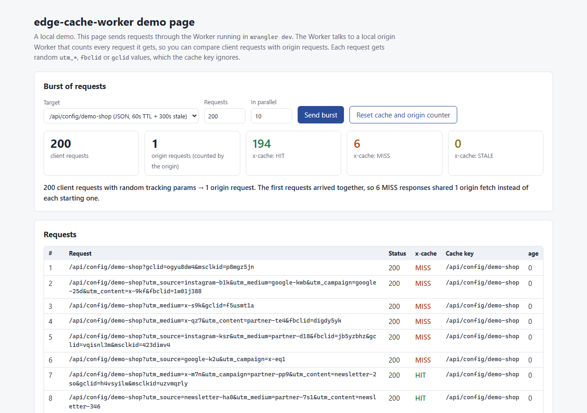
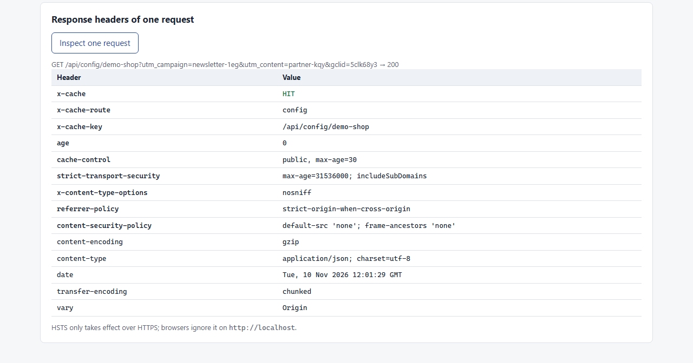

# edge-cache-worker

[](https://github.com/fatih255/edge-cache-worker/actions/workflows/ci.yml)

A Cloudflare Worker that sits in front of an origin serving an embed script and a JSON config API, and cuts origin traffic with normalized cache keys, stale-while-revalidate and edge security headers.



## Why this exists

At Popupsmart I worked on cache rules, Cloudflare Workers and PageSpeed scores so we used the origin more efficiently. The embed script served hundreds of millions of CDN requests a month. This repo is a small from-scratch version of that idea, not the production code or its rules. More in [my experience page](https://fatihinci.com/experience/#embedded-web).

## What it shows

- **Cache key normalization** ([src/cache-key.ts](src/cache-key.ts)): drops `utm_*`, `fbclid`, `gclid`, `msclkid` and similar params, sorts what's left, ignores the fragment and every request header. A route can list the params that matter (`keepParams`) and everything else is dropped.
- **Per-route policy in one file** ([src/policy.ts](src/policy.ts)):

  | Route | Edge TTL | Stale window | Browser |
  | --- | --- | --- | --- |
  | `/embed/v1.4.2/embed.js` | 1 year | none | `max-age=31536000, immutable` |
  | `/embed/latest.js` | 5 min | 1 hour | `max-age=300` |
  | `/api/config/<site>` | 60 s | 5 min | `max-age=30` |

- **Stale-while-revalidate in the Worker** ([src/handler.ts](src/handler.ts)): after the TTL, the stored copy is returned right away and the refetch runs in `ctx.waitUntil` using the Cache API. Requests for the same key that arrive while the origin is answering share one origin fetch.
- **No per-user leaks**: only the normalized URL goes to the origin (no cookies, auth or language headers), and `Set-Cookie` is stripped before storing.
- **Security headers at the edge**: HSTS, `X-Content-Type-Options`, `Referrer-Policy` on every response, a `default-src 'none'` CSP on the JSON route, and CORS with an allowlist (`ALLOWED_ORIGINS`). CORS is decided per request after the cache lookup, so one origin's header never sticks to the shared copy.
- **Visible behavior**: `x-cache: HIT | MISS | STALE | BYPASS`, plus `x-cache-key`, `x-cache-route` and `age`.
- **A local origin** ([origin/src/index.ts](origin/src/index.ts)): a second Worker that counts the requests it receives.

## Run it

```sh
npm install
npm run dev
```

Then open http://localhost:8701/__demo. `npm run dev` starts both Workers in one `wrangler dev` session, with the origin bound to the edge Worker as a service binding. Nothing is deployed and no Cloudflare login is needed.

The demo page fires a burst of requests with random tracking params and shows each one's `x-cache` next to the origin's own counter. On my machine (Windows 11, Chrome via Playwright, 10 requests in parallel), 200 requests to `/api/config/demo-shop` produced 1 origin request: 6 MISS responses that arrived together and shared that one fetch, then 194 HITs. That's a local demo result, not a production number.



`npm run screenshots` regenerates both images. It starts `npm run dev` if nothing is listening on port 8701.

## Tests

```sh
npm test
npm run typecheck
```

40 tests run inside workerd with [@cloudflare/vitest-pool-workers](https://www.npmjs.com/package/@cloudflare/vitest-pool-workers) and the real Cache API. Each test gets its own cache, its own origin counter and a fake clock, so TTL and stale windows are tested without waiting. They cover:

- key normalization cases (tracking params, case, order, encoding, `keepParams`)
- MISS → HIT → STALE → HIT after revalidation, and MISS again after the stale window
- one background refresh for 20 concurrent stale requests
- 200 concurrent requests with random tracking params → 1 origin request, and 200 sequential ones → 1 MISS and 199 HITs
- security headers on every route and on HITs, CORS allow/deny, preflights, lookalike origins
- headers not forwarded, `Set-Cookie` stripped, HEAD, bypass for other methods, 502 when the origin is down

## Limits

- Request coalescing is per isolate. Two isolates or two data centers can each go to the origin once.
- No purge API. Versioned paths handle deploys; the config route relies on its short TTL.
- `stale-if-error` isn't implemented. If the origin fails after the stale window, the client gets a 502.
- `@cloudflare/vitest-pool-workers` has since been renamed to `@cloudflare/vitest-plugin`; this repo pins the last release under the old name.

## License

MIT
